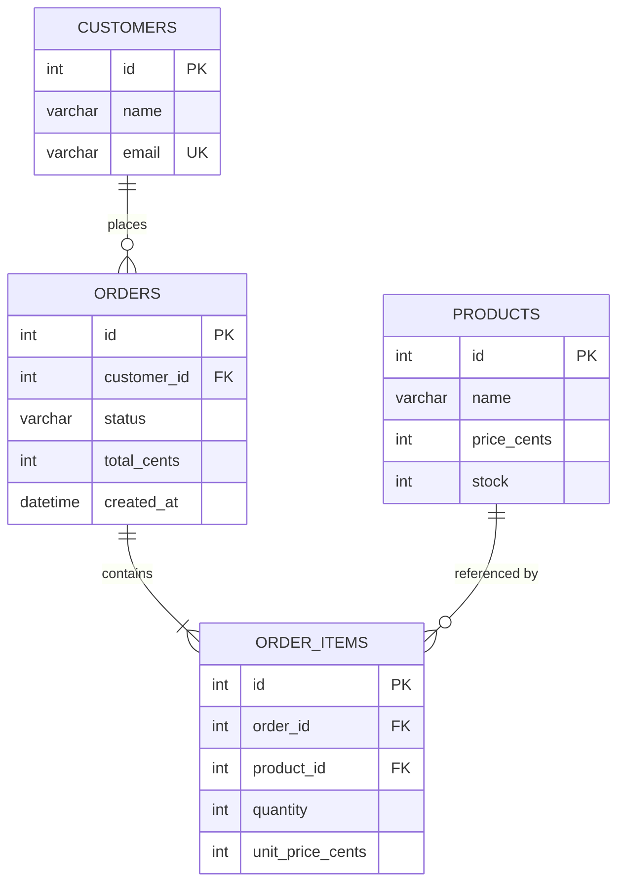

# Data model

SQLite, SQLAlchemy 2.x typed models. Foreign keys are enforced (`PRAGMA foreign_keys=ON` on every connection, see `app/db/session.py`).

## ER diagram

## Money

Money is stored as INTEGER cents (exact, no float) in columns named `*_cents`. The custom type `app.models.types.Money` converts to/from `Decimal` with 2 places, so ORM attributes (`price`, `unit_price`, `total`) are `Decimal`. Raw SQL sees cents.

## Tables

### customers
| column | type | constraints |
|---|---|---|
| id | INTEGER | PK |
| name | VARCHAR(200) | NOT NULL |
| email | VARCHAR(254) | NOT NULL, UNIQUE |

### products
| column | type | constraints |
|---|---|---|
| id | INTEGER | PK |
| name | VARCHAR(200) | NOT NULL, CHECK length(name) >= 1 |
| price_cents (attr `price`) | INTEGER | NOT NULL, CHECK >= 0 |
| stock | INTEGER | NOT NULL, default 0, CHECK >= 0 |

### orders
| column | type | constraints |
|---|---|---|
| id | INTEGER | PK |
| customer_id | INTEGER | NOT NULL, FK customers.id ON DELETE RESTRICT |
| status | VARCHAR(20) | NOT NULL, default PENDING, CHECK in (PENDING, PAID, SHIPPED, DELIVERED, CANCELLED) |
| total_cents (attr `total`) | INTEGER | NOT NULL, default 0, CHECK >= 0 |
| created_at | DATETIME | NOT NULL, default now (UTC, stored naive) |

Indexes: `ix_orders_customer_id`, `ix_orders_status`.

### order_items
| column | type | constraints |
|---|---|---|
| id | INTEGER | PK |
| order_id | INTEGER | NOT NULL, FK orders.id ON DELETE CASCADE |
| product_id | INTEGER | NOT NULL, FK products.id ON DELETE RESTRICT |
| quantity | INTEGER | NOT NULL, CHECK > 0 |
| unit_price_cents (attr `unit_price`) | INTEGER | NOT NULL, CHECK >= 0 |

Constraints: UNIQUE (order_id, product_id) (a product appears once per order).
Indexes: `ix_order_items_order_id`, `ix_order_items_product_id` (fast "product in use" check).

## Delete rules
- Product delete with order items: blocked by RESTRICT (IntegrityError) -> service maps to `PRODUCT_IN_USE`.
- Customer delete with orders: blocked (no endpoint exists).
- Order delete: items cascade (ORM `delete-orphan` and DB CASCADE). No endpoint exists.
